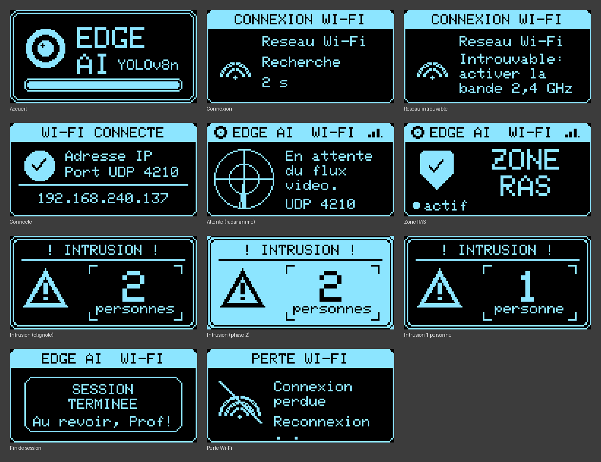

# Algorithme d'Apprentissage Automatique pour Système de Surveillance Edge AI

Projet de recherche réalisé dans le cadre du **Master 2 Recherche en Sciences de l'Ingénieur** à l'Université d'Ebolowa (UFD-SATI, Laboratoire de Physique et Applications Technologiques Industrielles).

Le système détecte localement les personnes dans un flux vidéo avec **YOLOv8n**, les suit d'une trame à l'autre (**BoT-SORT**), journalise les détections au format JSON et transmet le nombre de personnes détectées à un **ESP32** qui pilote un écran OLED et un voyant d'alarme, par **Wi-Fi (UDP)** ou **liaison série**. Aucune image ne quitte le poste local.

## 📁 Architecture du dépôt

* `ai_model/` : configuration du jeu de données (`data.yaml`) et script d'entraînement (`train.py`).
  * `weights/best.pt` : poids du modèle YOLOv8n affiné (meilleure époque, 74 sur 100), utilisables directement par les scripts d'inférence (`YOLO("ai_model/weights/best.pt")`).
* `pc_inference/` : scripts d'inférence temps réel en Python (OpenCV, Ultralytics) :
  * `detect_rt_INTRUSION_save_JSON_WIFI.py` : alerte par Wi-Fi (UDP, port 4210), seuil τ = 0,55 ;
  * `detect_rt_INTRUSION_save_JSON_SERIE.py` : alerte par liaison série (115 200 bauds), seuil τ = 0,35 ;
  * `detect_rt_INTRUSION_save_JSON.py` : première version (liaison série, sans mesure).
  
  Les deux premiers scripts chronomètrent chaque étape de la boucle et produisent un résumé statistique (`DUREE_MESURE_S` règle la durée de la session, 300 s par défaut).
* `firmware_esp32/` : micrologiciel PlatformIO / Arduino de l'ESP32 :
  * `main.cpp` : version liaison série ;
  * `main_WIFI.cpp` : version Wi-Fi UDP avec interface graphique animée sur l'OLED (renseigner `VOTRE_SSID` et `VOTRE_MOT_DE_PASSE` localement, **ne jamais publier les vrais identifiants**).
* `resultats/` : mesures temporelles de la chaîne complète (session Wi-Fi de 5 min).
* `docs/` : documentation technique.
* `documents/` : mémoire de Master 2 Recherche (version corrigée après soutenance) et présentation de la soutenance, au format PDF.

## 🖥️ Interface de l'afficheur OLED

La seconde version du micrologiciel est organisée en machine à états (attente du flux, zone RAS, intrusion, fin de session, perte du Wi-Fi). Chaque état a son écran : radar animé en attente, bouclier pour la zone RAS, alerte clignotante avec le nombre de personnes en cas d'intrusion, et puissance du signal Wi-Fi dans le bandeau. Le nœud lit tous les datagrammes reçus et garde le plus récent ; sans message pendant 3 s, il revient à l'écran d'attente.

Le script Python envoie par défaut en diffusion (`255.255.255.255`), ce qui fonctionne aussi avec le partage de connexion d'un téléphone (point d'accès en **2,4 GHz**, sécurité **WPA2**). Pour viser une adresse précise : `set ESP32_IP=192.168.x.y` avant de lancer le script.

## 📊 Résultats principaux

Modèle YOLOv8n affiné 100 époques (SGD, 640 × 640, lot 16) sur le jeu de données *CCTV Person Detection* (Université de Konkuk, Roboflow, CC BY 4.0) : 1 057 images d'entraînement, 213 de validation, 145 de test.

| Métrique (validation, 1 144 instances) | Valeur |
|---|---|
| Précision | 0,919 |
| Rappel | 0,899 |
| mAP@0.5 | 0,934 |
| mAP@0.5:0.95 | 0,508 |
| F1 maximal | 0,91 pour τ = 0,459 |

| Performances temporelles (GPU NVIDIA RTX A500) | Valeur |
|---|---|
| Modèle seul (prétraitement + inférence + NMS) | 7,1 ms par image |
| Chaîne complète, session Wi-Fi de 5 min (6 206 trames) | 47,9 ms par trame, soit 20,7 images/s |
| dont détection + suivi | 25,8 ms |
| dont annotation, vidéo, affichage | 12,9 ms |
| dont envoi UDP + journal JSON | 0,6 ms |

L'objectif de 25 images/s n'est pas encore atteint par la chaîne complète : le modèle laisse une large marge, c'est le reste de la boucle (prétraitement, suivi, affichage) qu'il faut optimiser.

## 🛠️ Technologies & Outils

* **IA & Vision :** [YOLOv8 / Ultralytics](https://github.com/ultralytics/ultralytics), [OpenCV](https://opencv.org/), [PyTorch](https://pytorch.org/).
* **Systèmes embarqués :** [ESP32](https://www.espressif.com/), [PlatformIO](https://platformio.org/), bibliothèques Adafruit SSD1306 et GFX.
* **Communication :** liaison série USB (CP2102) et Wi-Fi UDP.

## 🔒 Données personnelles

Les vidéos enregistrées (`Video_surveillance_*.avi`) et les journaux d'alertes (`Journal_Alertes_*.jsonl`) contiennent des images ou des positions de personnes : ils sont exclus du dépôt par le fichier `.gitignore`.

## ⚖️ Licence

Ce projet est mis à disposition selon les termes de la licence **[Creative Commons Attribution 4.0 International (CC BY 4.0)](https://creativecommons.org/licenses/by/4.0/)**.

Vous êtes libre de :
* **Partager** : copier et redistribuer le matériel sous n'importe quel format ou support.
* **Adapter** : remixer, transformer et construire à partir du matériel pour toute utilisation, y compris commerciale.

*Sous réserve de mentionner l'auteur original : KENGNE TAKAM Ibrahim Eric ([ORCID 0009-0002-5093-6440](https://orcid.org/0009-0002-5093-6440)).*
